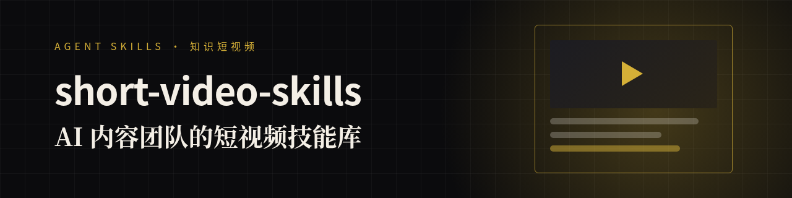

### 你好，我是「请叫我诗人」👋

我带着一支 **AI 智能体团队** 做两件事：**写顶刊论文**，做**知识类短视频**。
踩过的坑都写成了开源的 Agent Skills（`SKILL.md` 格式），Claude Code / Codex / Cursor 都能用。

| 技能库 | 做什么 |
|---|---|
| 🎬 **[short-video-skills](https://github.com/niuyupeng/short-video-skills)** | 知识短视频流水线：参考视频拆解 → 事实核查 → 封面 A/B → 一稿多投 |
| 🧪 **[CNS-Skills](https://github.com/niuyupeng/CNS-Skills)** | 面向 Cell / Nature / Science 的论文写作：证据矩阵、提纲、初稿、引文核验 |

**我的原则**：先学参考再动笔 · 每个事实都要有一手来源 · 如实标注 AI · 规则冲突时以最新为准

⭐ 如果这些技能帮你省了时间，点个 star 就是最好的支持，也欢迎提 issue 告诉我你的痛点。
